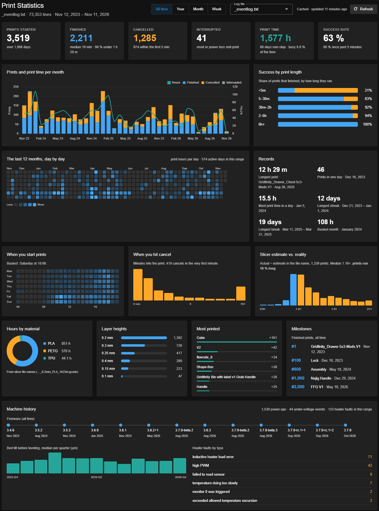
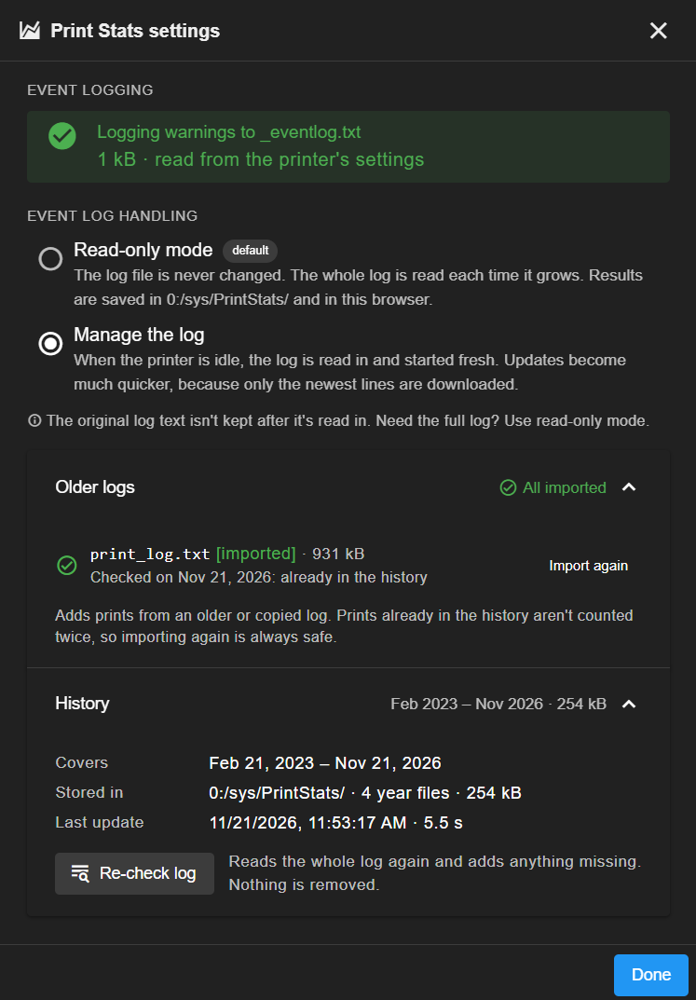

# Print Stats

A Duet Web Control 3.7 plugin that turns the RRF event log into a statistics dashboard
(**Plugins → Print Stats**), for all time or the last year, month or week.



- prints started, finished, cancelled and interrupted, print time, success rate
- prints and print time per month or day, success by print length, slicer estimate vs. actual time
- a 12-month calendar heatmap and a weekday × hour heatmap
- records, milestones, materials, layer heights and most printed parts
- firmware history, bed leveling over time, heater faults, power-ups

## New in 1.1.0



- **Opens instantly.** The history is kept on the printer in `0:/sys/PrintStats/` (one small file per year)
  and in the browser. Updates read only the new log lines and rewrite only the current year.
- **Setup dialog.** Shown on first use and from the gear button. The log file and level are read from the
  printer; if logging is off, it can be turned on until the next reboot. `config.g` is never changed.
- **Two ways to treat the log.** *Read-only mode* (default) never touches the log file. *Manage the log*
  reads the log in when the printer is idle and starts it fresh, so updates stay quick. The original log text
  is then not kept.
- **Import older logs**, such as a copied or renamed log, without counting anything twice. A dot on the gear
  button shows when a log is waiting to be imported.
- **Re-check log** adds anything the history is missing and never removes anything.
- Replaces 1.0.0's `printstats-cache.json`, which is removed once the new history exists.

## Install

Download `PrintStats-<version>.zip` from [Releases](https://github.com/fotomas/PrintStats/releases) and install it
in DWC under **Settings → Plugins → Install plugin**. Then open **Plugins → Print Stats** and follow the setup dialog.

Event logging must be on. Warning level is enough; to keep it on, add this to `config.g`:

```
M929 P"eventlog.txt" S1    ; S1 = warnings (S2 = info, S3 = debug)
```

Material, layer height, part name and slicer estimate come from OrcaSlicer/PrusaSlicer's default file name,
`{name}_{layer}mm_{material}_{1h23m}.gcode`. Other names still count, they just lack those details.

## Building

Needs a DuetWebControl 3.7 checkout with this folder in `src/plugins/PrintStats`.

- Development: `npm run dev` in the DWC folder loads the plugin as a built-in, with hot reload.
- Package: `build.bat` (set `DWC_DIR` if DWC is elsewhere) produces `PrintStats-<version>.zip`.

Main files: `src/PrintStatsPage.vue` (dashboard), `src/components/SetupDialog.vue` (settings),
`src/usePrintStats.ts` (loading, history, log rotation, import), `src/model/` (log parser, history files,
statistics).

## Licence

GPL-3.0-or-later
